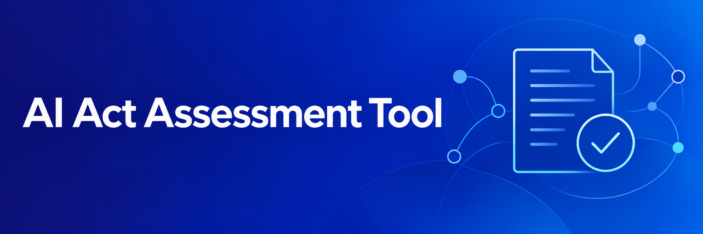

# AI Act Assessment Tool



An AI Act assessment tool that helps users identify potentially applicable
requirements and obligations based on their role, location and use of
an AI system or general-purpose AI model.

The application provides indicative classifications, obligations and
supporting explanations. It is an independent informational tool
and does not constitute legal advice.

## Tech Stack

- React for the interface.
- Vite for development and production builds.
- SurveyJS Core for questionnaire data and conditional visibility.

## Getting started

Install a Node.js version compatible with the Vite version specified
in package.json, together with npm.

Install the project dependencies:

```bash
npm ci
```

Start the development server:

```bash
npm run dev
```

To access the development server from another machine:

```bash
npm run dev -- --host 0.0.0.0
```

Use the address and port printed in the terminal.

## Production build

Generate the production files:

```bash
npm run build
```

The output is written to dist/.


## Project structure

```text
src/
├── App.jsx
├── main.jsx
├── components/
│   └── HtmlContent.jsx
├── domain/
│   └── assessment.js
├── features/
│   ├── questionnaire/
│   │   ├── QuestionCard.jsx
│   │   ├── SectionSidebar.jsx
│   │   ├── questionnaire.json
│   │   └── questionnaire-help.json
│   └── results/
│       └── ResultsPage.jsx
├── services/
│   └── assessmentStorage.js
└── styles/
    └── global.css
```

